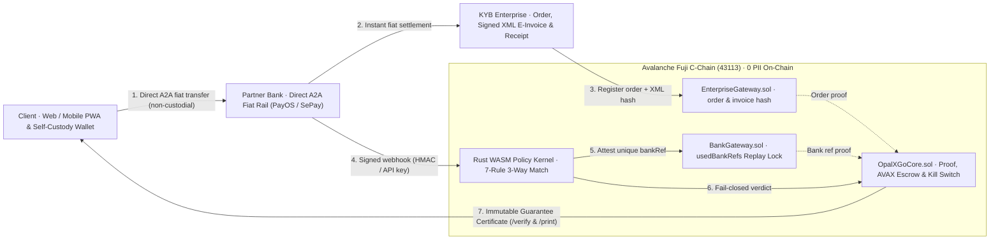

<div align="center">

<picture>
  <source media="(prefers-color-scheme: dark)" srcset="public/brand/bank-agent-logo-dark.png" />
  <source media="(prefers-color-scheme: light)" srcset="public/brand/bank-agent-logo.png" />
  
</picture>

# Bank Agent · OpalX GO

**Direct Bank Payments · Instant Avalanche Proofs · Non-Custodial Guarantee Protocol**

*Rail-agnostic bank-to-blockchain assurance infrastructure — live today with Vietnam's instant VietQR / NAPAS 247 rail adapter (PayOS & SePay), architected for global account-to-account networks.*

[-E84142?style=for-the-badge&logo=avalanche&logoColor=white)](https://testnet.snowtrace.io)
[](https://bankagent.opalx14.com)
[](crates/opalx-guard)
[](cloudflare.config.ts)
[](eval/run-eval.ts)
[](#3-party-non-custodial-architecture--dispute-protection)

</div>

---

> ### Live Production Deployment — [`https://bankagent.opalx14.com`](https://bankagent.opalx14.com)
>
> Deployed on **Cloudflare Workers** (`vinext` + KV + precompiled Rust `opalx_guard.wasm`) and connected live to **Avalanche Fuji C-Chain (`43113`)**:
>
> | Portal | Live URL | Purpose |
> | :--- | :--- | :--- |
> | **Personal / Client Portal** | [`bankagent.opalx14.com/`](https://bankagent.opalx14.com/) | Create direct bank payments, manage self-custody wallets, claim guarantee rights |
> | **Enterprise Portal** | [`bankagent.opalx14.com/enterprise`](https://bankagent.opalx14.com/enterprise) | KYB onboarding, service/prepayment packages, dynamic QR & XML e-invoice verification |
> | **Partner Bank Portal** | [`bankagent.opalx14.com/bank`](https://bankagent.opalx14.com/bank) | Instant bank rail registry (SePay / PayOS / Sandbox), `[SANDBOX]` vs `[LIVE BANK]` switch, Kill Switch |
> | **6-Pillar Verifier & Roadmap** | [`bankagent.opalx14.com/roadmap`](https://bankagent.opalx14.com/roadmap) | Real-time verification of all 6 Avalanche Fuji pillars + 4-phase roadmap |

---

## Why Avalanche & The 6 Verified Pillars

Instant bank transfers settle in seconds, yet prepayment disputes, counterfeit payment receipts, and opaque B2B reconciliation still take weeks to resolve. **Bank Agent · OpalX GO** bridges everyday fiat bank rails with verifiable cryptographic assurance on **Avalanche** — without ever custodying customer fiat:

- **Sub-Second Finality for Real-Time Receipt Proofs**: Instant account-to-account transfers require an equally fast attestation layer so the customer receives an immutable on-chain Guarantee Certificate and printable `58mm`/`80mm`/A4 receipt immediately upon bank confirmation.
- **Ultra-Low Native AVAX Gas**: Per-order commitment registration, anti-replay bank-reference locks, micro-verification fees (`0.00001 AVAX`), and AVAX collateral escrow run natively on C-Chain without fragile external stablecoin dependencies.
- **Full EVM & Canonical Ecosystem Standards**: Runs native Solidity `0.8.24` gateway contracts alongside Fuji's canonical **ERC-8004** Identity/Reputation/Validation registries, **Circle Fuji USDC (`x402` EIP-3009)**, and **Daimo P-256 Passkey** verification.
- **Institutional Upgrade Path to a Dedicated Avalanche L1**: Banking consortiums and national payment networks can seamlessly graduate from Fuji/C-Chain to a compliance-scoped **Avalanche L1** with custom validator governance and strict `0 PII on-chain` guarantees.

### Live Verified Stack on Avalanche Fuji C-Chain (`eip155:43113`)

Inspect live telemetry anytime via [`GET /api/avalanche/verify-stack`](https://bankagent.opalx14.com/api/avalanche/verify-stack) or the interactive verifier at [`/roadmap`](https://bankagent.opalx14.com/roadmap).

| # | Pillar | Component / Contract | Live Fuji Proof / Address |
| :---: | :--- | :--- | :--- |
| **1** | **Avalanche Fuji C-Chain** | Network `43113` (`eip155:43113`) live RPC telemetry | [Snowtrace Fuji Explorer](https://testnet.snowtrace.io) |
| **2** | **3 Independent Gateway Contracts** | [`EnterpriseGateway.sol`](contracts/src/enterprise/EnterpriseGateway.sol) — Side-1 order & e-invoice commitment registry<br>[`BankGateway.sol`](contracts/src/bank/BankGateway.sol) — Side-2 `usedBankRefs` anti-replay settlement oracle<br>[`OpalXGoCore.sol`](contracts/src/opalx/OpalXGoCore.sol) — Side-3 AVAX collateral vault, reputation credits & Kill Switch | [`0xaE97E6Bd...eF3f86CB`](https://testnet.snowtrace.io/address/0xaE97E6Bd5e581D2AFFa6364bdc5975f9eF3f86CB)<br>[`0xF7863338...F821e721`](https://testnet.snowtrace.io/address/0xF786333845a1b373b455D8f419b42291F821e721)<br>[`0xF83BbE11...28175fe4B`](https://testnet.snowtrace.io/address/0xF83BbE11F98c47423cC343823b15a1028175fe4B) |
| **3** | **Rust WASM Policy Kernel** | [`crates/opalx-guard`](crates/opalx-guard) (`opalx_guard.wasm`) — 7 deterministic 3-way reconciliation & circular wash-trade rules (`ALLOW` / `REQUIRE_APPROVAL` / `DENY`), fail-closed, 0 PII | `opalx_guard.wasm` · **40/40** adversarial eval (`100%` precision) |
| **4** | **ERC-8004 Identity & Reputation** | Canonical Identity, Reputation & Validation Registries + [`/api/agent-card`](https://bankagent.opalx14.com/api/agent-card) | Identity: [`0x8004A818...A494BD9e`](https://testnet.snowtrace.io/address/0x8004A818BFB912233c491871b3d84c89A494BD9e)<br>Reputation: [`0x8004B663...B7388713`](https://testnet.snowtrace.io/address/0x8004B663056A597Dffe9eCcC1965A193B7388713)<br>Validation: [`0x8004Cb1B...acEB4272`](https://testnet.snowtrace.io/address/0x8004Cb1BF31DAf7788923b405b754f57acEB4272) |
| **5** | **Circle Fuji USDC · `x402` EIP-3009** | Standard `x402` A2A settlement with EIP-712 domain `{ name: "USD Coin", version: "2" }` | [`0x54258902...1a31Bc65`](https://testnet.snowtrace.io/address/0x5425890298aed601595a70AB815c96711a31Bc65) |
| **6** | **Daimo P-256 Passkey Verifier** | Passwordless WebAuthn P-256 verification & member wallet guarantee-rights signing | [`0xc2b78104...B2754De4`](https://testnet.snowtrace.io/address/0xc2b78104907F722DABAc4C69f826a522B2754De4) |

---

## 3-Party Non-Custodial Architecture & Dispute Protection

OpalX GO enforces strict **3-Party Domain Separation**. Fiat funds travel directly account-to-account (A2A) between customer and enterprise via partner banks (live today on **VietQR / NAPAS 247** via PayOS and SePay, pluggable for SEPA Instant, FedNow, UPI, or Pix). **OpalX GO never holds fiat** and **never writes PII on-chain** — only salted `bytes32` cryptographic commitments.



### Product Authority & Deterministic Guardrails

AI is strictly bounded to extraction and proposal (`AI_BOUNDED_PROPOSAL` always sets `signatureValid: false`). Final settlement and guarantee issuance are decided exclusively by the **Rust WASM Policy Kernel** and **Avalanche Smart Contracts**, fail-closed across 7 checks:

1. Vault pause status (`OpalXGoCore.paused`)
2. Webhook cryptographic authentication (`PayOS HMAC-SHA256` constant-time / `SePay` API key)
3. Bank reference presence & on-chain replay protection (`BankGateway.usedBankRefs`)
4. Circular wash-trade graph detection (`A -> B -> ... -> A`)
5. Exact 3-way amount match (`Order === Bank Paid === XML E-Invoice`)
6. Tax e-invoice XML digital signature verification (`TT78_XML` when required)
7. Auto-approve ceiling (`<= 10,000,000 VND` auto-allow; higher amounts escalate to `REQUIRE_APPROVAL` for CFO Passkey)

### 3-Step Dispute & Complaint Resolution Flow

When a prepaid service is undelivered, duplicated, or contested, customers and partner banks resolve claims with verifiable cryptographic evidence instead of screenshots:

1. **Passkey / Wallet Guarantee Claim**: The customer initiates a cryptographically signed claim (`CLAIM_GUARANTEE_RIGHT`) tied to their `guaranteeId` using WebAuthn **P-256 Passkey** (`Daimo P-256 Verifier`) or their self-custodial EVM wallet.
2. **Immutable 3-Way Fuji Proof Audit**: Any stakeholder verifies the guarantee directly against Avalanche Fuji RPC at `/verify/[id]`, auditing the linked `orderCommitment` (`EnterpriseGateway`), `bankRefCommitment` (`BankGateway`), XML e-invoice commitment, and Rust WASM reconciliation verdict with zero PII exposure.
3. **On-Chain Kill Switch & AVAX Escrow Protection**: Authorized bank/protocol guardians can immediately trigger the on-chain Kill Switch (`OpalXGoCore.pause()` via `POST /api/policy/kill-switch`), revoke compromised guarantees (`GuaranteeRevoked`), enforce 24-hour spending caps (`dailyCapWei`), and protect counterparties via locked native **AVAX Collateral Escrow**.

---

## Decentralized Self-Custody & External Wallet Support

Bank Agent supports both **Web2-speed onboarding with real self-custody escape hatches** and **Web3-native external wallets**, issuing signed `HttpOnly` sessions with strict role-based access control (`CUSTOMER` / `ENTERPRISE` / `BANK`):

### 1. Zero-Popup Embedded Decentralized Wallet (Email / Google)
- **Deterministic EVM `secp256k1` Derivation**: Sign in with Email or Google (`POST /api/auth/wallet-login`) to instantly provision a standard EVM wallet and deterministic merchant-contract binding with zero browser popups.
- **1-Click Self-Custody Export (`POST /api/auth/wallet-export`)**: After acknowledging the self-custody notice, users can export either:
  - Raw EVM **Private Key** (`secp256k1`), or
  - Encrypted **Web3 Secret Storage V3 Keystore JSON** (`AES-128-CTR`, `PBKDF2-HMAC-SHA256` with `100,000` iterations, `keccak256` MAC).
- **Universal Portability**: Exported wallets import directly into **MetaMask**, **Core Wallet (Avalanche)**, **Rabby Wallet**, and **Foundry `cast`**. Responses enforce strict `Cache-Control: no-store, private, max-age=0` headers.

### 2. External Web3 Wallet Connect (Zero-Gas SIWE)
- **Native EIP-6963 & EIP-1193 Discovery**: Connect directly with **Core Wallet (Avalanche)**, **MetaMask**, or **Rabby** with no custodial intermediaries.
- **Stateless HMAC-Signed SIWE Challenge**:
  1. `POST /api/auth/wallet-login` (`mode: "EXTERNAL_CHALLENGE"`) issues a 5-minute TTL, HMAC-SHA256-authenticated Sign-In message bound to wallet address, role, domain, and Chain ID `43113`.
  2. The user signs with `personal_sign` (**0 gas, 0 PII on-chain**).
  3. `POST /api/auth/wallet-login` (`mode: "EXTERNAL_VERIFY"`) verifies both the stateless challenge token (constant-time HMAC + expiry + tamper hash) and the ECDSA signature via `viem.verifyMessage`.

---

## Tech Stack

| Layer | Technologies |
| :--- | :--- |
| **Web App & UI** | Next.js `16.3.6` (App Router), React `19.3.1`, Tailwind CSS v4, `lucide-react`, `qrcode`, `zod` |
| **Edge Deployment** | Cloudflare Workers (`vinext` + `@cloudflare/vite-plugin`), Cloudflare KV (`OPALX_LEDGER_KV`), static precompiled `opalx_guard.wasm` |
| **Deterministic Policy Kernel** | Rust (`crates/opalx-guard`) compiled to WebAssembly (`opalx_guard.wasm`) + TypeScript bridge (`src/core/opalx/policy-bridge.ts`) |
| **Blockchain & Cryptography** | Solidity `^0.8.24` + Foundry (`forge`), Avalanche Fuji C-Chain (`43113`), `viem`, `@x402/core`, `@x402/evm` |
| **Instant Bank Rail & E-Invoice** | VietQR EMVCo (`CRC-16/CCITT-FALSE`, `dl.vietqr.io`), PayOS (`@payos/node`, `HMAC-SHA256`), SePay webhooks, Circular 78 XML parser (`fast-xml-parser`) |

---

## Core Routes & API Reference

### Web Pages

| Route | Description |
| :--- | :--- |
| `/` | Personal / Client Portal — create direct payments, inspect active guarantees, manage embedded or external wallets |
| `/enterprise` | KYB Enterprise Portal — register enterprises, manage prepayment packages, generate dynamic QR & verify XML e-invoices |
| `/bank` | Partner Bank Portal — manage instant bank rails (SePay / PayOS / Sandbox), switch `[SANDBOX]` vs `[LIVE BANK]`, operate Kill Switch |
| `/opalx` | OpalX Core Protocol Console — treasury reserves, AVAX collateral metrics, reputation tiers (`/dashboard` routes here) |
| `/scan` | Mobile QR & Guarantee Certificate Scanner |
| `/verify/[id]` | Public On-Chain Guarantee Verifier — validates `guaranteeId` directly against Avalanche Fuji RPC (`43113`) |
| `/print/[id]` | Printable Guarantee Receipt — server-rendered layouts for **A4**, **80mm POS**, **58mm Thermal**, and **AirPrint** |
| `/roadmap` | Live 6-Pillar Avalanche Stack Verifier (`AvalancheTechVerifier`) & 4-Phase Roadmap (see also [`docs/ROADMAP.md`](docs/ROADMAP.md)) |

### Key API Endpoints

| Method & Endpoint | Description |
| :--- | :--- |
| `GET / POST /api/auth/wallet-login` | Session lookup, embedded wallet sign-in (`LOGIN`), external SIWE (`EXTERNAL_CHALLENGE` / `EXTERNAL_VERIFY`), role switch, wallet action signing, logout |
| `POST /api/auth/wallet-export` | Authenticated self-custody export (raw `secp256k1` private key + optional AES-128-CTR Web3 Keystore V3 JSON) |
| `GET /api/avalanche/verify-stack` | Live verification of all 6 Avalanche Fuji pillars (RPC telemetry, 3 Gateways, Rust WASM, ERC-8004, Circle USDC x402, Daimo P-256) |
| `GET /api/orders`<br>`POST /api/orders/create` | List orders or create a direct payment order (EMVCo QR, optional TT78 XML parsing, `EnterpriseGateway` commitment registration) |
| `POST /api/webhooks/payos` | Live PayOS webhook endpoint with constant-time `HMAC-SHA256` verification → 3-way reconciliation → `[LIVE BANK]` guarantee broadcast |
| `POST /api/webhooks/sepay` | Live SePay webhook endpoint with API-key authorization → automatic order-code matching → proof broadcast |
| `POST /api/sandbox/simulate-bank` | Controlled `[SANDBOX]` simulator for testing valid settlements and adversarial attack scenarios |
| `GET / POST /api/policy/kill-switch` | Inspect vault status or toggle on-chain `OpalXGoCore` `pause()` / `unpause()` emergency Kill Switch (Bank role required) |
| `GET /api/guarantees`<br>`GET /api/guarantees/[id]` | List guarantee certificates and verify individual guarantees live via Fuji C-Chain RPC |
| `GET /api/treasury/status`<br>`GET / POST /api/avax/settle-fee` | Inspect AVAX reserve, locked collateral, 24h cap, and settle native `0.00001 AVAX` verification fees |
| `GET /api/account-mode`<br>`GET / POST /api/bank/rails`<br>`GET / POST /api/enterprises` | Sandbox vs live mode status, partner bank rail configuration, and KYB enterprise & package management |
| `GET /api/agent-card`<br>`GET / POST /api/wallet/agent-session` | ERC-8004 Agent Discovery Card metadata and delegated agent signer session controls |

---

## Local Quickstart & Verification

### Prerequisites

- **Bun** `>= 1.2` (or Node.js `>= 20` + npm)
- **Rust / Cargo** (optional, for running `crates/opalx-guard` Rust tests)
- **Foundry (`forge`)** (optional, for compiling & testing Solidity contracts in `contracts/`)

### 1. Install & Configure

```bash
bun install
cp .env.example .env.local
```

> By default, `OPALX_SANDBOX_MODE="true"` lets you run the full 3-party workflow locally right away. Configure `PAYOS_*` / `SEPAY_WEBHOOK_API_KEY` for `[LIVE BANK]` webhooks and `AVALANCHE_ISSUER_PRIVATE_KEY` to broadcast live Fuji transactions (get testnet AVAX from the [Core Fuji Faucet](https://core.app/tools/testnet-faucet/?subnet=c&token=c)).

### 2. Run Locally

```bash
# Next.js 16 dev server (http://127.0.0.1:5238)
bun run dev

# Or run with the Cloudflare Workers + vinext local runtime (http://localhost:3001)
bun run dev:vinext
```

### 3. Run the Full Verification Suite

```bash
# Unit tests (auth, wallet export, webhooks, policy kernel, QR, e-invoice)
bun run test

# End-to-end integration tests
bun run test:e2e

# 40-case valid + adversarial policy evaluation suite (target: 40/40, 100% precision)
bun run eval

# Rust Policy Kernel tests & Foundry smart-contract tests
bun run guard:test
bun run contracts:test

# Typecheck & production builds (Next.js + Cloudflare Workers vinext bundle)
bun run typecheck
bun run build
npm run build:vinext
```

---

<div align="center">

Built on **Avalanche Fuji C-Chain (`43113`)** · Deployed on **Cloudflare Workers** · Zero Fiat Custody · Zero PII On-Chain

[**Open Live App**](https://bankagent.opalx14.com) · [**Verify 6 Avalanche Pillars**](https://bankagent.opalx14.com/roadmap) · [**Read 4-Phase Roadmap**](docs/ROADMAP.md)

</div>
